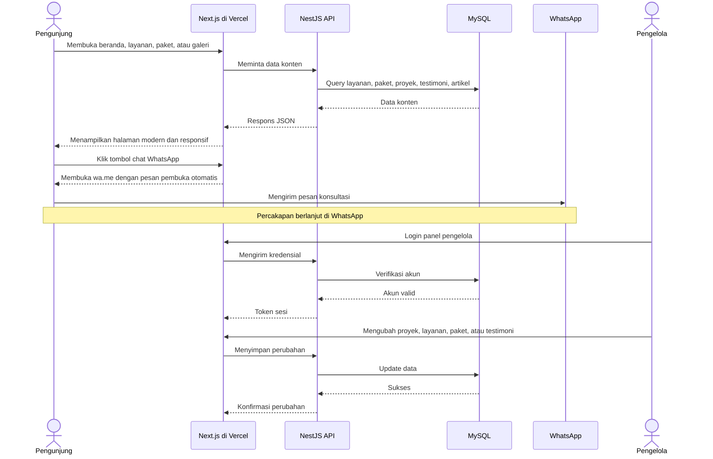
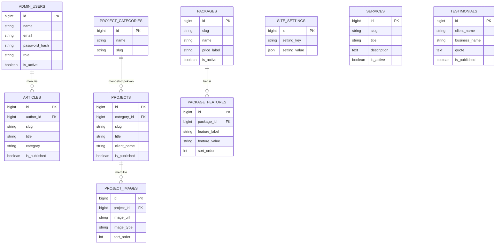

# PRD — Project Requirements Document

## 1. Overview

Paham Digital Agency adalah perusahaan digital yang membantu UMKM di Aceh Barat tampil lebih modern dan naik level melalui website, customer service AI, serta optimasi agar usaha lebih mudah ditemukan di Google dan berpeluang direkomendasikan oleh AI.

Masalah utama yang ingin diselesaikan adalah banyak UMKM sudah punya usaha bagus, tetapi belum memiliki kehadiran digital yang meyakinkan: belum punya website modern, belum punya layanan pelanggan otomatis, dan belum terlihat di Google. Website company profile ini dibuat sebagai etalase utama Paham Digital Agency untuk menjelaskan layanan, menunjukkan hasil kerja, menampilkan paket harga, membangun kepercayaan lewat testimoni, dan mengarahkan calon klien untuk langsung menghubungi tim melalui WhatsApp.

Tujuan utama aplikasi:
- Memperkenalkan Paham Digital Agency dan layanannya secara jelas dan modern.
- Menampilkan contoh hasil kerja agar calon klien yakin pada kualitas.
- Menjelaskan paket dan harga sebelum calon klien menghubungi tim.
- Mempermudah calon klien menghubungi tim lewat tombol WhatsApp langsung.
- Menjadi website yang ramah SEO dan mudah diperbarui oleh tim internal.

## 2. Requirements

- Website harus responsif dan nyaman dibuka di HP, tablet, dan desktop.
- Tampilan harus modern, rapi, dan mudah dipahami pemilik UMKM.
- Setiap halaman utama harus memiliki akses cepat ke WhatsApp.
- Konten layanan, paket harga, hasil kerja, testimoni, dan artikel harus jelas serta mudah dibaca.
- Website harus siap untuk SEO: struktur halaman rapi, judul dan deskripsi halaman jelas, sitemap, dan data terstruktur.
- Tombol WhatsApp harus menggunakan pesan pembuka otomatis agar pengunjung tidak bingung.
- Halaman paket harga harus bisa menampilkan daftar paket, perbandingan, layanan tambahan, dan tombol tanya paket.
- Galeri hasil kerja harus mendukung kategori, detail studi kasus, serta tampilan sebelum dan sesudah.
- Testimoni dan artikel harus bisa tampil sebagai bukti sosial dan konten yang membuat pengunjung kembali.
- Panel pengelola harus aman dan hanya bisa diakses tim internal.
- Tim internal harus bisa memperbarui hasil kerja, layanan, paket harga, dan testimoni tanpa bantuan teknis.
- Pengembangan dilakukan bertahap sesuai roadmap: Fase 1 fondasi dan WhatsApp, Fase 2 layanan-harga-portofolio, Fase 3 testimoni-artikel, Fase 4 panel pengelola.
- Website harus cepat, aman, dan siap dideploy di Vercel dengan database MySQL.

## 3. Core Features

### Fase 1 — Fondasi Kepercayaan & Kontak Cepat

- **Halaman Beranda** [high] — Layar utama yang langsung memperkenalkan Paham Digital Agency dan mengarahkan pengunjung untuk menghubungi kami.
  - **Sambutan & Identitas** — Menjelaskan siapa kami dan bagaimana kami membantu UMKM Aceh Barat tampil lebih modern.
  - **Sorotan Layanan** — Menampilkan sekilas layanan utama agar pengunjung cepat paham yang kami kerjakan.
  - **Ajakan Konsultasi** — Tombol besar yang mengajak pengunjung langsung berkonsultasi gratis.
  - **Hasil Kerja Terbaru** — Cuplikan proyek terbaru supaya pengunjung langsung melihat bukti kerja kami.

- **Chat WhatsApp** [high] — Pengunjung bisa langsung menghubungi kami lewat WhatsApp tanpa mengisi formulir panjang.
  - **Tombol Chat Melayang** — Tombol yang selalu terlihat di setiap halaman agar mudah dihubungi kapan saja.
  - **Pesan Pembuka Otomatis** — Pesan sudah terisi otomatis sehingga pengunjung tinggal kirim tanpa bingung menulis.
  - **Panduan Sebelum Chat** — Daftar hal yang sebaiknya disiapkan pengunjung sebelum menghubungi kami.

### Fase 2 — Informasi Layanan, Harga & Portofolio

- **Halaman Layanan** [high] — Menjelaskan secara jelas layanan yang tersedia beserta manfaatnya untuk bisnis UMKM.
  - **Pembuatan Website UMKM** — Penjelasan layanan website modern yang siap pakai untuk usaha kecil.
  - **Customer Service AI** — Penjelasan layanan asisten otomatis yang melayani pembeli kapan pun.
  - **Optimasi Google & AI** — Penjelasan cara usaha muncul di Google dan direkomendasikan oleh AI.
  - **Langkah Kerja Sama** — Gambaran tahapan dari konsultasi sampai website siap dipakai.

- **Paket & Harga** [high] — Pengunjung bisa melihat pilihan paket dan perkiraan biaya sebelum memutuskan.
  - **Daftar Paket** — Pilihan paket dengan isi dan manfaat masing-masing secara ringkas.
  - **Perbandingan Paket** — Tabel sederhana untuk membandingkan isi tiap paket.
  - **Tanya Paket via WhatsApp** — Tombol untuk menanyakan paket yang cocok langsung ke tim kami.
  - **Layanan Tambahan** — Pilihan tambahan yang bisa disesuaikan dengan kebutuhan usaha.

- **Galeri Hasil Kerja** [high] — Menampilkan contoh website dan pekerjaan kami agar pengunjung yakin pada kualitasnya.
  - **Daftar Proyek** — Kumpulan proyek yang pernah kami kerjakan lengkap dengan gambarnya.
  - **Detail Studi Kasus** — Cerita singkat masalah klien dan hasil setelah bekerja sama dengan kami.
  - **Filter Kategori** — Memudahkan pengunjung melihat contoh sesuai jenis usahanya.
  - **Sebelum & Sesudah** — Perbandingan tampilan bisnis klien sebelum dan sesudah dibantu kami.

### Fase 3 — Bukti Sosial & Konten

- **Testimoni Klien** [medium] — Menampilkan penilaian dan cerita klien agar pengunjung baru lebih percaya.
  - **Ulasan Pelanggan** — Komentar asli dari klien yang pernah memakai layanan kami.
  - **Profil Klien** — Sekilas informasi usaha klien yang bekerja sama dengan kami.
  - **Cerita Sukses UMKM** — Kisah singkat usaha kecil yang naik level setelah dibantu.

- **Artikel & Tips** [medium] — Berisi tips seputar bisnis digital yang membuat pengunjung betah dan kembali lagi.
  - **Daftar Artikel** — Kumpulan tulisan tips dan kabar terbaru seputar usaha digital.
  - **Detail Artikel** — Halaman baca lengkap dengan isi yang mudah dipahami pemilik usaha.
  - **Pencarian Artikel** — Membantu pengunjung menemukan topik yang ingin dibaca.
  - **Bagikan Artikel** — Pengunjung bisa membagikan artikel ke media sosial atau WhatsApp.

### Fase 4 — Panel Pengelola Internal

- **Panel Kelola Konten** [low] — Tim kami bisa memperbarui isi website sendiri tanpa bantuan teknis.
  - **Login Pengelola** — Akses khusus untuk tim agar hanya pengelola yang bisa mengubah isi.
  - **Kelola Hasil Kerja** — Menambah atau memperbarui contoh proyek yang tampil di website.
  - **Kelola Layanan & Harga** — Mengubah daftar layanan dan paket harga sesuai penawaran terbaru.
  - **Kelola Testimoni** — Memasukkan atau menyembunyikan ulasan klien yang ditampilkan.

## 4. User Flow

### Perjalanan Pengunjung Baru

1. Pengunjung menemukan Paham Digital Agency dari Google, rekomendasi AI, media sosial, atau tautan WhatsApp.
2. Pengunjung membuka **Halaman Beranda** dan langsung melihat sambutan, identitas Paham Digital Agency, serta sorotan layanan.
3. Pengunjung melihat cuplikan hasil kerja terbaru untuk menilai kualitas.
4. Pengunjung menekan tombol **Ajakan Konsultasi** atau **Tombol Chat Melayang**.
5. WhatsApp terbuka dengan **Pesan Pembuka Otomatis**; pengunjung dapat membaca **Panduan Sebelum Chat** lalu mengirim pesan.
6. Jika belum siap chat, pengunjung membuka **Halaman Layanan** untuk memahami Pembuatan Website UMKM, Customer Service AI, Optimasi Google & AI, dan Langkah Kerja Sama.
7. Pengunjung membuka **Paket & Harga**, melihat daftar paket, membandingkan isi paket, dan melihat layanan tambahan.
8. Pengunjung menekan **Tanya Paket via WhatsApp** untuk menanyakan paket yang sesuai.
9. Pengunjung membuka **Galeri Hasil Kerja**, memakai filter kategori, melihat detail studi kasus, dan membandingkan tampilan sebelum dan sesudah.
10. Pada Fase 3, pengunjung membaca **Testimoni Klien** dan **Artikel & Tips**; pengunjung dapat mencari artikel dan membagikannya ke media sosial atau WhatsApp.
11. Pengunjung yang tertarik kembali menghubungi tim melalui WhatsApp.

### Perjalanan Pengelola

1. Pengelola membuka **Login Pengelola** pada panel internal.
2. Pengelola masuk menggunakan akun yang sudah terdaftar.
3. Pengelola memperbarui **Kelola Hasil Kerja** untuk menambah proyek atau studi kasus baru.
4. Pengelola memperbarui **Kelola Layanan & Harga** saat ada penawaran atau paket baru.
5. Pengelola memperbarui **Kelola Testimoni** untuk menampilkan atau menyembunyikan ulasan klien.
6. Perubahan langsung tampil di website setelah disimpan.

## 5. Architecture

Paham Digital Agency menggunakan arsitektur sederhana: pengunjung mengakses website Next.js yang dideploy di Vercel, lalu website mengambil data konten dari API NestJS. API terhubung ke database MySQL untuk menyimpan layanan, paket, proyek, testimoni, artikel, dan pengaturan WhatsApp. Tombol WhatsApp tidak memerlukan server khusus karena memakai tautan langsung ke WhatsApp dengan pesan pembuka otomatis.

Untuk SEO, halaman publik Next.js dapat dirender di server atau dibuat statis agar cepat dan mudah dibaca mesin pencari. Panel pengelola dilindungi login, dan hanya pengelola yang bisa mengubah data melalui API.

## 6. Database Schema

### `admin_users`
Menyimpan akun pengelola panel.

| Field | Tipe | Kegunaan |
|---|---|---|
| id | BIGINT, PK | ID unik pengelola |
| name | VARCHAR(100) | Nama pengelola |
| email | VARCHAR(150), unique | Email untuk login |
| password_hash | VARCHAR(255) | Password terenkripsi |
| role | ENUM('admin','editor') | Hak akses pengelola |
| is_active | BOOLEAN | Status akun aktif/tidak |
| created_at | TIMESTAMP | Waktu akun dibuat |
| updated_at | TIMESTAMP | Waktu akun diperbarui |

### `site_settings`
Menyimpan pengaturan global website.

| Field | Tipe | Kegunaan |
|---|---|---|
| id | BIGINT, PK | ID unik pengaturan |
| setting_key | VARCHAR(100), unique | Nama pengaturan, misalnya `whatsapp_number`, `whatsapp_auto_message`, `chat_guidance`, `homepage_intro` |
| setting_value | JSON/TEXT | Nilai pengaturan |
| description | VARCHAR(255) | Keterangan singkat |
| updated_at | TIMESTAMP | Waktu pengaturan diperbarui |

### `services`
Menyimpan data layanan pada Halaman Layanan.

| Field | Tipe | Kegunaan |
|---|---|---|
| id | BIGINT, PK | ID unik layanan |
| slug | VARCHAR(120), unique | Alamat unik halaman layanan |
| title | VARCHAR(150) | Nama layanan |
| summary | VARCHAR(255) | Ringkasan singkat |
| description | TEXT | Penjelasan lengkap |
| benefits | JSON | Daftar manfaat layanan |
| icon | VARCHAR(100) | Nama ikon tampilan |
| sort_order | INT | Urutan tampil |
| is_active | BOOLEAN | Status tampil/tidak |
| created_at | TIMESTAMP | Waktu dibuat |
| updated_at | TIMESTAMP | Waktu diperbarui |

### `packages`
Menyimpan daftar paket harga.

| Field | Tipe | Kegunaan |
|---|---|---|
| id | BIGINT, PK | ID unik paket |
| slug | VARCHAR(120), unique | Alamat unik paket |
| name | VARCHAR(120) | Nama paket |
| description | TEXT | Penjelasan paket |
| price_label | VARCHAR(100) | Label harga, misalnya "Mulai dari Rp..." |
| is_popular | BOOLEAN | Penanda paket populer |
| sort_order | INT | Urutan tampil |
| is_active | BOOLEAN | Status tampil/tidak |
| created_at | TIMESTAMP | Waktu dibuat |
| updated_at | TIMESTAMP | Waktu diperbarui |

### `package_features`
Menyimpan isi tiap paket untuk tabel perbandingan.

| Field | Tipe | Kegunaan |
|---|---|---|
| id | BIGINT, PK | ID unik fitur paket |
| package_id | BIGINT, FK ke `packages.id` | Paket pemilik fitur |
| feature_label | VARCHAR(150) | Nama fitur, misalnya "Jumlah halaman" |
| feature_value | VARCHAR(150) | Isi fitur, misalnya "5 halaman" |
| sort_order | INT | Urutan tampil |

### `project_categories`
Menyimpan kategori untuk filter galeri.

| Field | Tipe | Kegunaan |
|---|---|---|
| id | BIGINT, PK | ID unik kategori |
| name | VARCHAR(100) | Nama kategori |
| slug | VARCHAR(120), unique | Alamat unik kategori |
| sort_order | INT | Urutan tampil |

### `projects`
Menyimpan data proyek dan studi kasus.

| Field | Tipe | Kegunaan |
|---|---|---|
| id | BIGINT, PK | ID unik proyek |
| category_id | BIGINT, FK ke `project_categories.id` | Kategori proyek |
| slug | VARCHAR(120), unique | Alamat unik proyek |
| title | VARCHAR(150) | Judul proyek |
| client_name | VARCHAR(150) | Nama klien |
| summary | VARCHAR(255) | Ringkasan proyek |
| problem | TEXT | Masalah klien sebelum dibantu |
| solution | TEXT | Solusi yang diberikan |
| result | TEXT | Hasil setelah bekerja sama |
| thumbnail_url | VARCHAR(255) | Gambar utama proyek |
| project_url | VARCHAR(255), nullable | Tautan website klien bila ada |
| is_published | BOOLEAN | Status tampil/tidak |
| sort_order | INT | Urutan tampil |
| created_at | TIMESTAMP | Waktu dibuat |
| updated_at | TIMESTAMP | Waktu diperbarui |

### `project_images`
Menyimpan gambar tambahan proyek, termasuk sebelum dan sesudah.

| Field | Tipe | Kegunaan |
|---|---|---|
| id | BIGINT, PK | ID unik gambar |
| project_id | BIGINT, FK ke `projects.id` | Proyek pemilik gambar |
| image_url | VARCHAR(255) | Lokasi gambar |
| image_type | ENUM('thumbnail','before','after','gallery') | Jenis gambar |
| caption | VARCHAR(255), nullable | Keterangan gambar |
| sort_order | INT | Urutan tampil |

### `testimonials`
Menyimpan ulasan dan cerita klien.

| Field | Tipe | Kegunaan |
|---|---|---|
| id | BIGINT, PK | ID unik testimoni |
| client_name | VARCHAR(150) | Nama klien |
| business_name | VARCHAR(150) | Nama usaha klien |
| client_photo_url | VARCHAR(255), nullable | Foto klien |
| quote | TEXT | Isi testimoni |
| rating | TINYINT, nullable | Nilai 1–5 bila ada |
| is_published | BOOLEAN | Status tampil/tidak |
| sort_order | INT | Urutan tampil |
| created_at | TIMESTAMP | Waktu dibuat |

### `articles`
Menyimpan artikel dan tips.

| Field | Tipe | Kegunaan |
|---|---|---|
| id | BIGINT, PK | ID unik artikel |
| author_id | BIGINT, FK ke `admin_users.id` | Penulis artikel |
| slug | VARCHAR(120), unique | Alamat unik artikel |
| title | VARCHAR(150) | Judul artikel |
| excerpt | VARCHAR(255) | Ringkasan artikel |
| content | LONGTEXT | Isi lengkap artikel |
| cover_image_url | VARCHAR(255) | Gambar sampul |
| category | VARCHAR(100) | Kategori artikel |
| published_at | TIMESTAMP, nullable | Waktu terbit |
| is_published | BOOLEAN | Status tampil/tidak |
| created_at | TIMESTAMP | Waktu dibuat |
| updated_at | TIMESTAMP | Waktu diperbarui |

## 7. Tech Stack

| Bagian | Rekomendasi | Alasan |
|---|---|---|
| Frontend | Next.js + TypeScript | Cepat, modern, ramah SEO, cocok untuk company profile dan halaman konten |
| Styling | Tailwind CSS | Mempercepat pembuatan tampilan modern dan responsif |
| Komponen UI | shadcn/ui | Komponen rapi, konsisten, dan mudah disesuaikan |
| Backend | NestJS + TypeScript | Struktur API yang rapi untuk layanan, paket, proyek, testimoni, artikel, dan panel admin |
| Database | MySQL 8 | Stabil, umum digunakan, dan sesuai kebutuhan data konten |
| ORM | Prisma ORM | Mempermudah pengelolaan database MySQL dan migrasi |
| Autentikasi Admin | JWT + bcrypt/argon2 | Melindungi panel pengelola dengan aman |
| Integrasi WhatsApp | Tautan `wa.me` dengan pesan otomatis | Sederhana, cepat, dan tidak memerlukan formulir panjang |
| Deployment | Vercel untuk Next.js dan API serverless; MySQL di layanan database terkelola | Sesuai kebutuhan deployment Vercel dan database MySQL |
| SEO | Next.js Metadata API, sitemap, robots.txt, JSON-LD | Membantu halaman mudah dipahami Google dan mesin rekomendasi AI |
| Analitik & Pemantauan | Google Search Console | Memantau performa halaman di Google tanpa menambah fitur baru ke website |